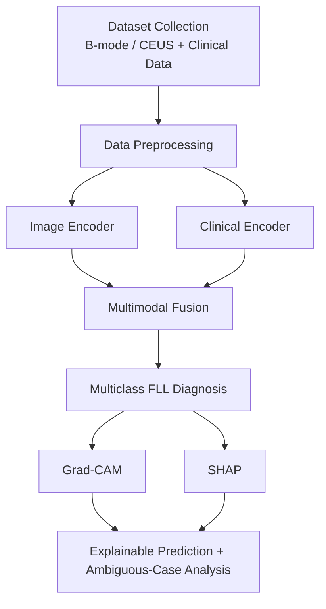

# XMAI: Explainable Multimodal AI for Differential Diagnosis of Focal Liver Lesions
## Consolidated Design Document (build spec)

---

## 0. How to read this document

**Sources merged**
- `IR` = Initial Report (Mini Project: Initial Report)
- `CA2` = Continuous Assessment 2 (resources, risks, dataset, EDA)
- `CA3` = Continuous Assessment 3 (novelty, methodology, first-level results)
- `CA4` = Continuous Assessment 4 (fusion approaches, setup, results, next steps)

**Tags used**
- `[SRC: x]` = taken from source x, verbatim or near-verbatim. Quotation marks mean exact wording.
- `[DESIGN]` = my proposal, NOT in any source. Safe to reject.
- `[OPEN]` = unresolved in the sources. Needs a team decision before coding.
- `[FLAG]` = contradiction or weakness found in the sources. See Section 15.

**Rule followed:** no number, class name or claim appears without a source tag unless marked `[DESIGN]`.

---

## 1. Project identity

- Title: "XMAI for Differential Diagnosis of Focal Liver Lesions" `[SRC: all]`
- Course: Multimodal AI Lab, Mini Project `[SRC: all]`
- Programme: Bachelor of Technology in Artificial Intelligence & Machine Learning `[SRC: all]`
- Institute: Symbiosis Institute of Technology, Pune (Pune - 412115, Maharashtra State, India) `[SRC: all]`
- Department: Artificial Intelligence & Machine Learning, AY 2026-27 `[SRC: all]`
- Group: 14
- Guide: Dr. Nivedita Mishra (Faculty Professor in CA3/CA4) `[SRC: CA3, CA4]`

### 1.1 Team and responsibilities `[SRC: CA2, Table 1]`

| Team member | ID | Primary responsibility | Current work |
|---|---|---|---|
| Eric Siqueira | 23070126041 | Imaging Data & Preprocessing (Project Lead) | Dataset organization, DICOM inspection, B-mode/CEUS extraction, Image preprocessing and Image and clinical feature pipeline. |
| Ameya Tipnis | 23070126012 | Multimodal Modelling & Documentation | Multimodal fusion architecture, fusion strategies, literature support and documentation |
| Asho Thekkeparampil | 23070126023 | Clinical Data & Evaluation | Clinical-data exploration, feature preparation, evaluation metrics and comparative analysis |
| Bhoomika Kapde | 23070126025 | Explainability & Dataset analysis | Grad-CAM/SHAP workflow, result interpretation, Data cleaning and visualization |

### 1.2 Compute plan `[SRC: CA2]`
- Python with deep-learning and medical-imaging libraries.
- Complete TCIA collection is approximately 272.16 GB, so "storage, preprocessing time and repeated experimentation" are resource considerations.
- GPU used "mainly during model training"; inspection, clinical-data analysis and dataset organization on CPU-based systems.

---

## 2. Problem, motivation, objectives

### 2.1 Problem statement `[SRC: IR]`
"The problem addressed in this project is therefore the development of an explainable multimodal AI framework capable of combining ultrasound-derived information with structured patient context for more reliable, fine-grained differential diagnosis of focal liver lesions."

Background points:
- B-mode ultrasound and CEUS interpretation is affected by operator experience and visual overlap between lesion types.
- Hard pairs: atypical HCC vs FNH or hemangioma.
- Existing systems mostly do binary benign-vs-malignant and use imaging as primary or only source.

### 2.2 Core research question `[SRC: IR]`
"can patient context help the model correctly diagnose cases that are ambiguous from ultrasound imaging alone?"

### 2.3 Motivation (summary) `[SRC: IR]`
- A radiologist reads an image with age, liver disease history, hepatitis status, cirrhosis, AFP level and lesion characteristics. An imaging-only model "is therefore being asked to make a decision with less information than may be available to the clinician."
- Two needs: use patient context for difficult decisions, and make decisions interpretable.
- "The aim is not to replace clinical judgement, but to investigate whether multimodal AI can provide more useful and transparent decision support than an image-only classifier."

### 2.4 Objectives `[SRC: IR]`
1. Acquire and preprocess B-mode/CEUS ultrasound data along with relevant structured clinical and laboratory information for focal liver lesion diagnosis.
2. Develop and evaluate unimodal image-only and clinical-only models to establish baseline diagnostic performance for each modality.
3. Develop a multimodal fusion model and analyse the additional diagnostic insights gained from combining ultrasound and clinical context.
4. Evaluate the multimodal system using standard performance metrics and integrate explainable AI methods for visual as well as clinical-feature interpretation.

---

## 3. Novelty (what the code must make demonstrable) `[SRC: CA3, Section 1]`

- N1. **Multiclass, not binary.** HCC, hemangioma, FNH, metastasis and cyst are separate outcomes. "atypical HCC is confused with FNH".
- N2. **Falsifiable question, not a leaderboard point.** Study how clinical history combines in cases that are failures for the image-only model. "This possibility of studying ambiguous cases is very rare in literature."
- N3. **Dual-mode explainability.** Grad-CAM for visual evidence; SHAP for individual clinical factors. Reported side by side.
- N4. **Data-availability constraint.** Clinical feature set is "defined basing on what the TCIA collection is able to show us", and the algorithm "can adapt to the circumstances of missing items."

**Code implication `[DESIGN]`:** every claim above needs an artifact the code must produce: per-class metrics (N1), a rescue/harm table (N2), Grad-CAM + SHAP figures for the same patient (N3), a missingness-aware clinical loader (N4).

---

## 4. Dataset specification

### 4.1 Source `[SRC: CA2, Table 3; CA4]`

| Property | Value |
|---|---|
| Dataset | B-mode-and-CEUS-Liver: Ultrasound Data of a Variety of Liver Masses |
| Repository | The Cancer Imaging Archive (TCIA) |
| Contributor | Researchers from Thomas Jefferson University |
| Anatomical region | Liver |
| Subjects | 120 |
| Studies / Series | 120 / 120 |
| DICOM objects | 1,859 |
| Modality | Ultrasound |
| Imaging types | B-mode and Contrast-Enhanced Ultrasound |
| Supporting data | Diagnosis, follow-up and treatment information (separate XLSX) |
| Published size | 272.16 GB |
| Licence | CC BY 4.0 |
| DOI | 10.7937/TCIA.2021.v4z7-tc39 |

### 4.2 Acquisition facts `[SRC: CA2]`
- Acquired in clinical trials on two problems: characterization of indeterminate liver lesions and assessment of treatment response following locoregional therapy.
- Different modern scanners with curvilinear probes.
- Sagittal and transverse orientations; complete CEUS cine loops kept in DICOM.
- Reference standards: pathology and contrast-enhanced cross-sectional imaging close to the ultrasound examination.
- Reported by other researchers: heterogeneous spatial resolutions, aspect ratios, single-frame data, multi-frame sequences, and "examinations where B-mode and CEUS are presented in a dual-panel arrangement."
- Key principle: "the number of imaging objects should not be interpreted as the number of independent patients." Patient is the experimental unit.

### 4.3 Class distribution `[SRC: CA3 Table 1, CA4, CA2 Fig 2]`

| Diagnostic category | Subjects | Share of cohort |
|---|---|---|
| Hepatocellular carcinoma (HCC) | 38 | 31.7% |
| Metastasis | 22 | 18.3% |
| Hemangioma | 18 | 15.0% |
| Focal nodular hyperplasia (FNH) | 12 | 10.0% |
| Other benign lesions | 10 | 8.3% |
| Other / Unspecified | 20 | 16.7% |

`[FLAG]` There is no "Cyst" row, yet the model is five-class including cyst. See Section 15, issue F1.

### 4.4 Modalities `[SRC: CA2, Section 4]`
- **B-mode:** "lesion shape, boundary, internal echogenicity, texture and surrounding tissue." Primary structural imaging branch.
- **CEUS:** enhancement over time after contrast agent. Full cine loops available, so temporal information can be modelled instead of treating each CEUS observation as an independent image.
- **Structured clinical/reference info:** separate spreadsheet with diagnosis, follow-up and treatment information. "Only variables actually available and sufficiently complete in this spreadsheet will be incorporated into the final clinical branch."

### 4.5 Clinical variable availability `[SRC: CA2, Table 4]`

| Clinical variable | Data type | Available records | Missing records | Missing (%) | Planned processing |
|---|---|---|---|---|---|
| Diagnosis | Categorical | 120 | 0 | 0.00% | Harmonize labels and encode target classes |
| Age | Numerical | Not available currently | 120 | 100.00% | Normalize/standardize if obtained |
| Sex | Categorical | Not available currently | 120 | 100.00% | Encode if obtained |
| Lesion information | Numerical/Categorical | 120 | 0 | 100.00% (as printed) | Derive/harmonize lesion information from diagnosis/reference data |
| Treatment information | Categorical | 59 | 61 | 50.83% | Encode TACE response; retain only for relevant analysis |
| Follow-up information | Categorical/Numerical | Not available currently | 120 | 100.00% | Assess and preprocess if additional metadata is obtained |

- CA4 update: "Age, sex, AFP, hepatitis and cirrhosis were later made available."
- AFP, hepatitis, cirrhosis were "desirable clinical inputs" in IR but "will not be assumed to exist in this particular dataset unless confirmed during clinical-data inspection." `[SRC: CA2]`
- `[FLAG]` Table 4 prints "0 missing" next to "100.00%" for lesion information, and CA2 vs CA4 disagree on age/sex availability. See F2, F3.

---

## 5. End-to-end data flow

### 5.1 Pipeline diagram `[SRC: IR Fig 1, CA3 Fig 1]`



### 5.2 Stage-by-stage contract

**Stage 1. Ingest `[SRC: CA3 2.1]`**
- Input: TCIA DICOM files (1,859 objects) + clinical XLSX.
- Two parallel channels. DICOM channel: "analyzed for number of frames, resolution, and details regarding the type of modality", then divided into B-mode images and CEUS sequences.
- Build mappings between patient identifiers, imaging data and reference information before training. `[SRC: CA2 5.1]`
- Output: patient-indexed manifest.

**Stage 2. Imaging preprocessing `[SRC: CA2 5.4, CA3 2.1, CA4]`**
- DICOM loading
- Relevant frame extraction (CEUS: "reduction of frames during the CEUS phase", "normalization of brightness")
- Image resizing
- Intensity normalization
- Removal of unsuitable or unreadable observations where necessary
- Handle: single-frame vs multi-frame, dual-panel B-mode+CEUS layout, varied resolution and aspect ratio
- Sample CEUS frames "without producing an unnecessarily large number of highly similar frames."
- Augmentation (flips, mild rotation, contrast jitter) applied only inside the training partition.

**Stage 3. Clinical preprocessing `[SRC: CA2 5.3-5.4]`**
- Data-type correction, missing-value handling, categorical encoding, numerical scaling where appropriate.
- Compute per variable: counts, missing %, duplicates, subjects per diagnostic category; mean/median/SD/range for numerics; frequency distributions for categoricals.
- "Patient identifiers will be used to align the clinical and imaging records but will not be supplied to the model as predictive features."
- IR scope of clinical variables: age, sex, presence or absence of hepatitis/cirrhosis, AFP, lesion size. Final vector = only what is confirmed available.

**Stage 4. Split `[SRC: CA2, CA4]`**
- Patient-level train/validation/test. Images of one subject must never appear in multiple partitions.
- Withheld validation split used for early stopping.
- Final plan (CA4 next steps): patient-level cross-validation, report mean ± standard deviation or confidence intervals.

**Stage 5. Encoders `[SRC: CA3 2.2]`**
- Image encoder: CNN/transformer (ResNet baseline, vision transformer for comparison), applied to B-mode and, if available, CEUS frames "either processed in a frame-wise manner or averaged in a short CEUS video."
- Clinical encoder: "small feed-forward tabular network."

**Stage 6. Fusion + head `[SRC: CA3 2.2, CA4]`**
- Embeddings taken from penultimate-layer outputs of the two encoders, fed to a trainable fusion network, final five-class softmax (HCC, hemangioma, FNH, metastasis, cyst).

**Stage 7. Evaluation and explainability `[SRC: CA3 2.3]`**
- Metrics per branch under identical protocol. Grad-CAM on images, SHAP on clinical inputs, combined and reported for image-ambiguous cases.

### 5.3 Tensor-level interface `[DESIGN]`
Not specified in any source. Suggested minimal contract:
- `image_input`: B-mode frame(s), and optional CEUS frame stack, normalized, fixed size `[OPEN: size]`
- `clinical_input`: fixed-length vector + missingness mask `[OPEN: fields]`
- `img_emb`, `clin_emb`: penultimate-layer vectors
- `logits`: 5 classes

---

## 6. Model architecture

### 6.1 Branches `[SRC: IR, CA3, CA4]`
- **Image-only:** variants (a) B-mode, (b) B-mode + CEUS.
- **Clinical-only:** small feed-forward tabular network on encoded diagnosis-adjacent and treatment fields confirmed available.
- **Multimodal fusion:** embedding-level fusion network.

### 6.2 Fusion approaches considered `[SRC: CA4, Section 2]`

| | Early fusion | Late fusion | Hybrid fusion (used in XMAI) |
|---|---|---|---|
| Where modalities meet | At input or shallow-feature level, before a joint network | At decision level, after each branch produces class probabilities | At embedding level: penultimate-layer outputs of both encoders are fused by a trainable network |
| Implementation | Clinical vector concatenated with or injected into image features; one joint network trained end to end | Image-only and clinical-only models trained separately; probabilities combined by weighted averaging or a stacking classifier | Image encoder (ResNet baseline, ViT for comparison) and tabular clinical network produce embeddings; a fusion network yields the five-class softmax |
| Strength | Can learn low-level cross-modal interactions | Simple, robust, tolerant of a missing modality | Learns high-level interactions while keeping modality-specific encoders |
| Weakness | Low-dimensional clinical data is easily swamped by image features; high overfitting risk with few subjects | Cannot model feature interactions; a weak clinical model adds little | Needs both embeddings during training; more parameters to tune |

- Explainability by fusion type `[SRC: CA4]`: late fusion "offers the simplest attribution (per-branch contributions)", early fusion "the hardest to separate by modality."
- Status: only hybrid fusion has been run. Early and late are planned.

### 6.3 Decision tree: which fusion to run first `[DESIGN]`

```
Is a clinical vector available for ALL subjects?
├─ Yes → run hybrid (primary), then early and late under identical protocol
└─ No (missing values remain)
     ├─ Is missingness random-ish and < ~50% per field?  [OPEN threshold]
     │    └─ Impute + missing-mask, run hybrid
     └─ Else
          └─ Run late fusion first (tolerates missing modality, per CA4)
             and train hybrid with modality dropout
```

---

## 7. Training protocol `[SRC: CA3 2.3, CA4 Section 1]`

- Loss: class-weighted cross-entropy (class imbalance).
- Augmentation: flips, mild rotation, contrast jitter, training only.
- Transfer learning: ImageNet-pretrained backbones, fine-tuned.
- Early stopping on a withheld validation split, "given the limited number of subjects."
- Identical protocol for all three branches "allowing us to directly attribute any improvement of the multimodal model."
- Patient-level splitting.
- Mitigation from CA2 risk table: "weighted loss or balanced sampling if required", regularization, standardized dimensions and intensity.
- Not specified anywhere: optimizer, learning rate, batch size, epochs, image size, seed. `[OPEN]`

---

## 8. Evaluation specification

### 8.1 Task `[SRC: CA4 Section 3]`
- Five-class classification (HCC, hemangioma, FNH, metastasis, cyst).
- Branches: image-only (B-mode; B-mode + CEUS), clinical-only, multimodal fusion.

### 8.2 Metrics `[SRC: CA3, CA4]`
- Accuracy
- Per-class precision, recall (sensitivity), F1, specificity
- One-vs-rest ROC-AUC (macro-averaged)
- Confusion matrices (for each branch)
- Ambiguous-case rescue rate: "the share of image-only errors corrected by the multimodal model."
- Also required `[SRC: CA4 next steps]`: "also count cases the fusion model gets wrong that image-only got right."

### 8.3 Reporting templates

**Template A. Branch comparison `[SRC: CA4 4.1 layout]`**

| Branch | Accuracy | Macro AUC | Notes |
|---|---|---|---|
| Image-only (B-mode) | | | |
| Image-only (B-mode + CEUS) | | | |
| Clinical-only | | | |
| Hybrid fusion | | | |
| Early fusion | | | planned |
| Late fusion | | | planned |

**Template B. Per-class `[SRC: CA4 4.2 layout]`**

| Lesion Type | Precision | Recall | F1-Score | Specificity | AUC-ROC |
|---|---|---|---|---|---|
| HCC | | | | | |
| Hemangioma | | | | | |
| FNH | | | | | |
| Metastasis | | | | | |
| Cyst | | | | | |
| Macro Average | | | | | |

**Template C. Patient-level `[SRC: CA4 4.3 layout]`**

| Patient ID | Model | HCC | Hemangioma | FNH | Metastasis | Cyst | Prediction | True Label |
|---|---|---|---|---|---|---|---|---|

**Template D. Rescue/harm `[DESIGN]`**

| Count | Value |
|---|---|
| Image-only errors (n) | |
| Rescued by fusion (n, %) | |
| Image-only correct, fusion wrong (n) | |
| Both wrong (n) | |
| Net gain | |

### 8.4 Ambiguous-case definition
- Source wording: "cases where the image only approach fails but multimodal output gives the correct diagnoses." `[SRC: IR]`
- Worked example `[SRC: CA4]`: PT-001, image-only 45.8% hemangioma vs 42.1% HCC. Fused moved 6.3 percentage points to HCC, flipping to the correct label. "The margin is narrow, so this should be described as a successful rescue of an uncertain case rather than a confident correction."
- Formal "uncertain" threshold (e.g. top-2 margin) is not defined. `[OPEN]`

---

## 9. Explainability specification `[SRC: IR, CA3, CA4]`

- **Grad-CAM** on ultrasound images: "contribution of pixels of each image for each prediction."
- **SHAP** on clinical features: "importance ranking of inputs related to the health data."
- Report both side by side for each ambiguous case. "image-ambiguous images ... is the main deliverable of the project in terms of explainability."
- Motivation from literature: Grad-CAM explains spatial attention "but cannot explain interactions between image evidence and patient variables" `[SRC: IR, ref 20]`, hence SHAP.
- Next step: "Produce Grad-CAM and SHAP figures for the rescued cases."
- `[DESIGN]` note: Grad-CAM on a ViT or on multi-frame CEUS needs a defined target layer and frame aggregation rule. Not specified in sources. `[OPEN]`

---

## 10. Results reported so far (provisional)

Context `[SRC: CA3 3.3]`: "provisional web-scraped cohort (N=120)". Targets were "calibrated conservatively" for a five-way task and "a restricted cohort size with sparse clinical inputs."

### 10.1 Branch results `[SRC: CA3 Table 2, CA4 4.1]`

| Evaluation branch | Projected target (5-class, small cohort) | Initial result | Notes |
|---|---|---|---|
| Image-only (B-mode) | Acc. 55-65% | Acc. 58.3% | Target met; baseline bounded by initial web-scraped resolution |
| Image-only (B-mode+CEUS) | Acc. 65-75% | Acc. 67.1% | Target met; validates the diagnostic utility of contrast-enhanced data |
| Clinical-only | Acc. 35-45% | Acc. 38.5% | Target met; weak independently due to limited feature availability |
| Multimodal fusion | Acc. 70-80%, AUC 0.80-0.88 | Acc. 72.4%, AUC 0.81 | Target achieved |
| Ambiguous-case rescue | Recover ≥ 20-30% of errors | 22.5% rescue rate | Target achieved |

- "improvement of 5.3 points over the best image-only model" `[SRC: CA4]`

### 10.2 Per-class, hybrid fusion `[SRC: CA4 4.2]`

| Lesion Type | Precision | Recall | F1-Score | Specificity | AUC-ROC |
|---|---|---|---|---|---|
| HCC | 0.72 | 0.69 | 0.70 | 0.78 | 0.79 |
| Hemangioma | 0.75 | 0.78 | 0.76 | 0.81 | 0.82 |
| FNH | 0.68 | 0.65 | 0.66 | 0.84 | 0.77 |
| Metastasis | 0.71 | 0.66 | 0.68 | 0.79 | 0.76 |
| Cyst | 0.85 | 0.87 | 0.86 | 0.88 | 0.89 |
| Macro Average | 0.74 | 0.73 | 0.73 | 0.82 | 0.81 |

- Cysts most separable (anechoic B-mode appearance). FNH and metastasis weakest, "in line with the literature on overlapping enhancement patterns."

### 10.3 Patient-level predictions `[SRC: CA4 4.3]`

| Patient ID | Model | HCC | Hemangioma | FNH | Metastasis | Cyst | Prediction | True Label |
|---|---|---|---|---|---|---|---|---|
| PT-001 | Image-only (uncertain) | 42.1% | 45.8% | 2.1% | 8.2% | 1.8% | Hemangioma | HCC |
| PT-001 | Multimodal (fused) | 48.4% | 38.2% | 2.5% | 8.9% | 2.0% | HCC | HCC |
| PT-002 | Multimodal (fused) | 4.2% | 48.5% | 4.4% | 1.4% | 5.5% | Hemangioma | Hemangioma |
| PT-003 | Multimodal (fused) | 5.5% | 3.8% | 47.2% | 7.4% | 5.1% | FNH | FNH |
| PT-004 | Multimodal (fused) | 18.8% | 2.5% | 3.9% | 42.3% | 2.5% | Metastasis | Metastasis |
| PT-005 | Multimodal (fused) | 1.1% | 2.8% | 1.2% | 1.4% | 43.5% | Cyst | Cyst |

`[FLAG]` Rows PT-002 to PT-005 do not sum to 100%. See F6.

### 10.4 Qualitative imaging priors `[SRC: CA3 3.2]` (use as sanity checks for Grad-CAM)
- **Cyst:** sharply marginated, anechoic (black) round structures with posterior acoustic enhancement. Most visually distinctive.
- **Hemangioma:** well-defined, homogeneously hyperechoic on B-mode; CEUS shows peripheral nodular enhancement in arterial phase with slow, centripetal fill-in.
- **FNH:** usually resembles normal liver tissue on B-mode; on CEUS shows striking arterial-phase enhancement, even with a central scar.
- **HCC:** varied B-mode echogenicity; CEUS shows typical perfusion changes in arterial and portal-venous/later phases.
- CEUS phases in CA2 Fig 1: arterial (~15 s), portal venous (~60 s), late (~120 s). `[SRC: CA2]`

---

## 11. Risk register `[SRC: CA2, Table 2]`

| Identified risk | Possible impact | Planned mitigation |
|---|---|---|
| Large dataset size | Slow downloading, preprocessing and storage overhead | Process data incrementally and maintain an organized local dataset structure |
| Limited number of subjects | Deep models may overfit despite the large number of DICOM objects | Transfer learning, regularization and suitable augmentation |
| Class imbalance | Model may favour frequently occurring lesion categories | Examine class distribution and use weighted loss or balanced sampling if required |
| Scanner/acquisition variability | Differences unrelated to pathology may influence predictions | Standardize image dimensions and intensity preprocessing |
| Missing clinical information | Some desired clinical features may not be available for every patient | Analyse missingness before selecting clinical variables |
| Patient-level data leakage | Images from one patient appearing across train and test sets could inflate performance | Perform all dataset splitting at the patient level |
| CEUS temporal variability | Different sequence lengths can complicate temporal modelling | Standardize frame selection or sampling strategy |
| Model interpretability | High accuracy without interpretable evidence limits clinical usefulness | Use Grad-CAM for imaging and SHAP for structured features |

---

## 12. Timeline `[SRC: IR, Table 2]`
Planned window: "between 1st week of September and 3rd week of October".

| Period | Planned work | Deliverable |
|---|---|---|
| Start of Sept | Finalize proposal, literature review and dataset selection | Progress report |
| Sept 1-13 | Dataset collection, cleaning and preprocessing | Prepared multimodal dataset |
| Sept 14-27 | Develop image-only, clinical-only and multimodal models | Baseline and fusion models |
| Sept 28-Oct 4 | Model tuning and performance comparison | Optimized model |
| Oct 5-11 | Explainability and ambiguous-case analysis | Grad-CAM, SHAP and analysis |
| Oct 12-18 | Testing and deployment | Working prototype |
| Oct 19-21 | Final deployment, results and documentation | Final system and report |

---

## 13. Literature baseline (benchmarks to beat or contextualize) `[SRC: IR, Table 1]`

| Ref | Authors, year | Data | Key result | Gap relevant to XMAI |
|---|---|---|---|---|
| [1] | Schmauch et al., 2019 | 367 2-D US images dev; independent 177 patients | ROC-AUC 0.935 detection, 0.916 characterization | Small dev set, image-only, no clinical context |
| [2] | Yang et al., 2020 | 24,343 images, 2,143 patients, 13 hospitals | External AUC 0.924; exceeded highly experienced radiologists in reported comparison | Binary benign/malignant |
| [3] | Tiyarattanachai et al., 2021 | 40,397 images, 3,487 patients | High specificity; HCC, cysts, hemangiomas identified | No patient context |
| [4] | Tiyarattanachai et al., 2022 | 446 videos, 334 patients, >1.5 million frames | ~89.8% FLL detection, ~30-34 fps | Detection only |
| [5] | Căleanu et al., 2021 | CEUS: FNH, HCC, hemangioma, hyper/hypovascular metastases | ~88% accuracy across five FLL types; leave-one-patient-out + hard voting | Small data, no clinical info |
| [6] | Zhao et al., 2023 | Pooled multi-site CEUS | 88.64% benign/malignant; 91.27% HCC/ICC (ResNet-50 + HAE + NFA) | Binary tasks, no clinical data |
| [7] | Zhou et al., 2024 | 420 FLLs (136 benign, 284 malignant) | 2-D CNN + LSTM mean AUC ~0.91 vs 3-D CNN 0.88 vs TIC-based 0.78 | Binary, no clinical variables |
| [8] | Strohm et al., 2025 | Dynamic liver CEUS | ~82% balanced accuracy for washout classification | Predicts one CEUS trait only |
| [9] | Oezsoy et al., 2025 | 370 patients, 955,938 CEUS images | AUROC ~0.94; attention-based multiple-instance learning | Binary, no clinical variables |
| [10] | Ding et al., 2025 | 52 centres; CEUS videos + biomarkers + clinical; six FLL categories | Outperformed junior CEUS radiologists, approached senior CEUS/MRI readers | Proprietary data; no explicit context-rescue analysis |
| [11] | Liu et al., 2022 | 303 patients, three hospitals; CEUS + AFP + hepatitis | Full multimodal AUC 0.969 internal, 0.957 external (four 3-D CNN models) | Only AFP and hepatitis; binary |
| [12] | Li et al., 2021 | 226 lesions: 107 atypical HCC, 119 FNH | Ultrasomics AUC 0.86; combined 0.93 (3,132 features, SVM) | Only FNH vs atypical HCC |
| [13] | Turco et al., 2022 | Clinical CEUS, benign/malignant | Interpretable radiomics (perfusion, spatiotemporal, texture) | No clinical context in explanation |
| [14] | Mămuleanu et al., 2023 | 50 CEUS videos, 49 patients; age, gender, cirrhosis, hepatitis | NN combining clinical variables with time-intensity features (max intensity, AUC, mean transit time, time-to-peak) | Very small cohort, overfitting risk |
| [15] | Urhuț et al., 2023 | 49 patients, 59 tumours | AI vs clinicians on CEUS; multiclass harder than binary | Small sample; unequal context |
| [16] | Tangruangkiat et al., 2024 | 581 US images, five classes | Pretrained ResNet-50 ~87 ± 2.2% CV accuracy | No CEUS or clinical context |
| [17] | Shen et al., 2024 | Sonazoid CEUS + Sound Touch Elastography + clinical | Multimodality + clinical improved benign/malignant prediction | Binary; modalities may be unavailable publicly |
| [18] | Dadoun et al., 2022 | 2,551 B-mode images, 1,026 patients; test 155 images, 48 patients | DETR ~97% sensitivity, 90% specificity for detection | Characterization benign/malignant; clinical history unavailable. Relevance cell is blank in the source table. |
| [19] | Xu et al., 2026 | 687 patients (285 benign, 402 malignant) | ResNet-18 B-mode + CEUS fusion: AUC ~0.994, accuracy ~96.38% | Binary; clinical variables only as subgroups |
| [20] | Lingamaiah et al., 2026 | SYSU-FLLCEUS | DarkNet-19 + Bottleneck Attention Module + phase-aware frame selection; Grad-CAM | No clinical integration |

Review conclusion `[SRC: IR 5.2]`: the field is still mostly benign-vs-malignant; "Fine-grained differential diagnosis, transparent integration of clinical context and explicit evaluation of diagnostically ambiguous cases remain less extensively explored."

---

## 14. Decision trees for implementation

### 14.1 Label construction `[OPEN, DESIGN]`
```
Target classes = {HCC, hemangioma, FNH, metastasis, cyst}  [SRC]
Dataset labels = {HCC, Metastasis, Hemangioma, FNH, Other benign, Other/Unspecified}  [SRC]

Where do cysts live in the spreadsheet?
├─ Explicit cyst label exists in a column → map directly
├─ Cysts sit inside "Other benign" (n=10) → relabel using reference data, document the rule
└─ No cyst subjects can be identified
     └─ Drop "cyst" from the target set (4-class), OR add external data.
        Do NOT report cyst metrics (Section 10.2) until resolved.

What happens to "Other/Unspecified" (n=20) and unmapped "Other benign"?
├─ Exclude from the 5-class experiment → effective n shrinks, report it
└─ Keep as a 6th class → breaks the stated five-class design
```

### 14.2 Clinical feature selection `[SRC rule + DESIGN steps]`
```
For each candidate field:
├─ Is it present in the spreadsheet? (No → exclude; do not assume)
├─ Missing % acceptable? → threshold [OPEN]
├─ Does it encode the diagnosis or outcome itself ("diagnosis-adjacent")? 
│    ├─ Yes → leakage risk, exclude from the primary model, test as ablation
│    └─ No  → keep
├─ Is it only known after treatment (e.g. TACE response)?
│    └─ Yes → exclude from diagnostic model (not available at diagnosis time)
└─ Keep → encode / scale → feed clinical encoder
```

### 14.3 Ambiguous-case analysis
```
For each test patient:
├─ Image-only correct?
│    ├─ Yes → fusion correct? (Yes: stable | No: HARM case, report)
│    └─ No  → fusion correct? (Yes: RESCUE | No: unresolved)
└─ Rescue rate = RESCUE / (all image-only errors)       [SRC definition]
   For each RESCUE and HARM case: Grad-CAM + SHAP figure
```

---

## 15. Adversarial validation of the source documents

Checked against your preference for adversarial validation rather than reassurance. Ranked by risk to the project's validity.

### Critical

- **F1. The cyst class has no data source.** The five target classes include cyst. The 120-subject table has no cyst row (HCC 38, metastasis 22, hemangioma 18, FNH 12, other benign 10, other/unspecified 20). Yet Section 10.2 reports cyst as the best class (F1 0.86, AUC 0.89). Either cysts are hidden in "Other benign" (10 subjects, unstated) or the cyst numbers are unsupported. Also, 5 classes x ~12-38 subjects each means FNH has 12 subjects total. Resolve before any code is written.
- **F2. Clinical features contradict across documents.** CA2 Table 4: age and sex 100% missing, follow-up not available. CA3: results obtained with "sparse clinical inputs (lacking AFP or hepatitis status)". CA4: "Age, sex, AFP, hepatitis and cirrhosis were later made available." The 38.5% clinical-only and 72.4% fusion results do not state which feature set produced them. If the later metadata was added after the reported run, the results are stale.
- **F3. Probable label leakage in the clinical branch.** The clinical network uses "diagnosis-adjacent and treatment fields." A field adjacent to the diagnosis can encode the label, and treatment response (TACE) is only known after diagnosis. Clinical-only accuracy of 38.5% vs 20% chance (five classes) hints at signal that may be leakage, not clinical context. The central claim ("patient context helps ambiguous cases") is only valid if the features exist at diagnosis time.
- **F4. Results provenance is inconsistent.** CA3 says results come from a "provisional web-scraped cohort (N=120)" and image-only is "bounded by initial web-scraped resolution." CA2 and CA4 say the data is the TCIA DICOM collection. Clarify what was actually trained on.

### High

- **F5. Test-set size and variance are not reported.** With 120 subjects, a held-out set is likely a few dozen patients. A 5.3-point gain (67.1% to 72.4%) and a 22.5% rescue rate can be one or two patients. The reported accuracies are not clean fractions of 120 (e.g. 72.4% x 120 = 86.9), so the evaluation denominator is unstated. Report n, per-class counts and confidence intervals. CA4 itself asks for cross-validation with mean ± SD.
- **F6. Patient-level table does not sum to 100%.** PT-001 rows sum to 100.0%. PT-002 sums to 64.0%, PT-003 to 69.0%, PT-004 to 70.0%, PT-005 to 50.0%. The softmax outputs are either incomplete (missing a class or truncated) or mislabeled.
- **F7. Rescue rate has no harm counterpart in the results.** CA4 asks to count cases fusion gets wrong that image-only got right, but Section 10 has no such number. A 22.5% rescue with equal harm is no gain. Also unclear which image-only baseline (B-mode or B-mode+CEUS) defines the 22.5%.
- **F8. Missing-modality claim conflicts with the fusion design.** CA3 says embedding-level fusion "will have the ability to continue functioning if there are problems with a certain type of data." CA4 says hybrid fusion "Needs both embeddings during training" and that late fusion is the one "tolerant of a missing modality." Without modality dropout or masking, the hybrid model will not survive a missing branch. N4 (missing-item adaptation) is therefore unsupported as designed.
- **F9. "Hybrid fusion is expected to lead" is untested.** Early and late fusion have not been run. The discussion section is a hypothesis, not a finding.

### Medium

- **F10. Single-run, small-data training.** Deep fine-tuning with 12-38 subjects per class is high variance. Seeds and variance not reported.
- **F11. Dual-panel B-mode/CEUS frames.** CA2 notes some examinations place B-mode and CEUS in one frame. If not split, "B-mode-only" results may leak CEUS information, inflating the B-mode baseline relative to the claim.
- **F12. Unspecified "multi-frame" aggregation.** "Frame-wise or averaged" is an unresolved fork; averaging CEUS frames removes the temporal wash-in/washout signal that justifies CEUS.
- **F13. Table 4 internal error.** Lesion information shows 120 available, 0 missing, 100.00% missing.
- **F14. Editorial leftovers.** CA4 says "replace every †" but no † appears. Ref [18] relevance cell blank; "benign/malignignant" typo in [19]. CA2 cites "a recent study using the same TCIA collection" without a reference.
- **F15. CA3 Figure 2 caption.** "Initial trained model results on a CEUS image" shows an image with dotted ROI circles but no visible model output. Replace with an actual Grad-CAM output.

---

## 16. Build plan

### 16.1 Experiment matrix `[SRC: CA4 + next steps]`

| ID | Branch | Inputs | Status |
|---|---|---|---|
| E1 | Image-only | B-mode | Run (provisional) |
| E2 | Image-only | B-mode + CEUS | Run (provisional) |
| E3 | Clinical-only | Clinical vector | Run (provisional) |
| E4 | Hybrid fusion | Image + clinical embeddings | Run (provisional) |
| E5 | Early fusion | Clinical injected at input/shallow level | To do |
| E6 | Late fusion | Probability-level combination | To do |

All must use identical splits and protocol.

### 16.2 Suggested repository layout `[DESIGN]`
```
xmai/
├─ data/            raw DICOM, clinical xlsx, manifest.csv (patient_id, paths, label, split)
├─ preprocess/      dicom_inspect, split_panels, ceus_sampling, clinical_clean
├─ models/          image_encoder, clinical_encoder, fusion_{early,late,hybrid}
├─ train/           class-weighted CE, early stopping, patient-level folds
├─ eval/            metrics, confusion, rescue_harm
├─ explain/         gradcam, shap, side_by_side
└─ reports/         tables A-D, figures
```

### 16.3 Definition of done `[SRC: CA4 next steps]`
- Early- and late-fusion experiments run under identical protocol.
- All models repeated on full dataset with patient-level cross-validation, mean ± SD or confidence intervals.
- Ambiguous-case rescue rate for each fusion strategy, plus count of fusion-wrong/image-right cases.
- Grad-CAM and SHAP figures for the rescued cases.
- Provisional web-scraped metrics replaced by "finalized performance results measured on the fully secured image dataset and an isolated, held-out test partition." `[SRC: CA3]`

### 16.4 Pre-coding checklist `[DESIGN]`
- [ ] Resolve F1 (cyst label source)
- [ ] Resolve F2 and F3 (final clinical feature list, timing-of-availability audit)
- [ ] Decide "Other benign / Other-Unspecified" handling
- [ ] Decide CEUS frame strategy (F12) and dual-panel split (F11)
- [ ] Fix split protocol (nested CV vs single hold-out) and record seeds
- [ ] Define "uncertain" threshold for ambiguous cases
- [ ] Define missing-modality handling (F8)

---

## 17. Dataset availability `[SRC: CA2]`
- Dataset: B-mode-and-CEUS-Liver: Ultrasound Data of a Variety of Liver Masses
- Access: B-mode-and-CEUS-Liver, The Cancer Imaging Archive
- DOI: https://doi.org/10.7937/tcia.2021.v4z7-tc39

---

## 18. References `[SRC: IR]`

1. Schmauch B, et al. (2019). Diagnosis of focal liver lesions from ultrasound using deep learning. Diagnostic and Interventional Imaging, 100(4), 227-233. https://doi.org/10.1016/j.diii.2019.02.009
2. Yang Q, et al. (2020). Improving B-mode ultrasound diagnostic performance for focal liver lesions using deep learning: A multicentre study. EBioMedicine, 56, 102777. https://doi.org/10.1016/j.ebiom.2020.102777
3. Tiyarattanachai T, et al. (2021). Development and validation of artificial intelligence to detect and diagnose liver lesions from ultrasound images. PLoS ONE, 16(6), e0252882. https://doi.org/10.1371/journal.pone.0252882
4. Tiyarattanachai T, et al. (2022). The feasibility to use artificial intelligence to aid detecting focal liver lesions in real-time ultrasound: a preliminary study based on videos. Scientific Reports, 12(1), 7749. https://doi.org/10.1038/s41598-022-11506-z
5. Căleanu CD, Sîrbu CL, Simion G. (2021). Deep Neural Architectures for Contrast Enhanced Ultrasound (CEUS) Focal Liver Lesions Automated Diagnosis. Sensors, 21(12), 4126. https://doi.org/10.3390/s21124126
6. Zhao L, et al. (2023). A unified end-to-end classification model for focal liver lesions. Biomedical Signal Processing and Control, 86 Part B, 105260. https://doi.org/10.1016/j.bspc.2023.105260
7. Zhou H, Ding J, Zhou Y, et al. (2024). Malignancy diagnosis of liver lesion in contrast enhanced ultrasound using an end-to-end method based on deep learning. BMC Medical Imaging, 24, 68. https://doi.org/10.1186/s12880-024-01247-y
8. Strohm H, Rothlübbers S, Jenne J, et al. (2025). Deep-learning-based washout classification for decision support in contrast-enhanced ultrasound examinations of the liver. Journal of Medical Imaging, 12(4), 044502. https://doi.org/10.1117/1.JMI.12.4.044502
9. Oezsoy A, et al. (2025). Weakly Supervised Deep Learning Can Analyze Focal Liver Lesions in Contrast-Enhanced Ultrasound. Digestion, 106(6), 502-514. https://doi.org/10.1159/000545098
10. Ding W, et al. (2025). Contrast-enhanced ultrasound-based AI model for multi-classification of focal liver lesions. Journal of Hepatology, 83(2), 426-439. https://doi.org/10.1016/j.jhep.2025.01.011
11. Liu L, et al. (2022). Deep learning radiomics for focal liver lesions diagnosis on long-range contrast-enhanced ultrasound and clinical factors. Quantitative Imaging in Medicine and Surgery, 12(6), 3213-3226. https://doi.org/10.21037/qims-21-1004
12. Li W, et al. (2021). Machine Learning-Based Ultrasomics Improves the Diagnostic Performance in Differentiating Focal Nodular Hyperplasia and Atypical Hepatocellular Carcinoma. Frontiers in Oncology, 11, 544979. https://doi.org/10.3389/fonc.2021.544979
13. Turco S, et al. (2022). Interpretable Machine Learning for Characterization of Focal Liver Lesions by Contrast-Enhanced Ultrasound. IEEE TUFFC, 69(5), 1670-1681. https://doi.org/10.1109/TUFFC.2022.3161719
14. Mămuleanu M, et al. (2023). An Automated Method for Classifying Liver Lesions in Contrast-Enhanced Ultrasound Imaging Based on Deep Learning Algorithms. Diagnostics, 13(6), 1062. https://doi.org/10.3390/diagnostics13061062
15. Urhuț M-C, et al. (2023). Diagnostic Performance of an Artificial Intelligence Model Based on Contrast-Enhanced Ultrasound in Patients with Liver Lesions: A Comparative Study with Clinicians. Diagnostics, 13(21), 3387. https://doi.org/10.3390/diagnostics13213387
16. Tangruangkiat S, et al. (2024). Diagnosis of focal liver lesions from ultrasound images using a pretrained residual neural network. J Appl Clin Med Phys, 25, e14210. https://doi.org/10.1002/acm2.14210
17. Shen Q, et al. (2024). A non-invasive predictive model based on multimodality ultrasonography images to differentiate malignant from benign focal liver lesions. Scientific Reports, 14, 23996. https://doi.org/10.1038/s41598-024-74740-7
18. Dadoun H, et al. (2022). Deep learning for the detection, localization, and characterization of focal liver lesions on abdominal US images. Radiology: Artificial Intelligence, 4(3), e210110. https://doi.org/10.1148/ryai.210110
19. Xu T, et al. (2026). Diagnosis of small focal liver lesions (≤2 cm): A deep learning approach based on B-mode ultrasound and contrast-enhanced ultrasound. Ultrasound in Medicine & Biology, 52(9), 1816-1825. https://doi.org/10.1016/j.ultrasmedbio.2026.01.002
20. Lingamaiah SC, et al. (2026). Attention-based deep learning model for clinical assessment of focal liver lesions using ultrasound imaging. Biomedical Signal Processing and Control, 116, 109563. https://doi.org/10.1016/j.bspc.2026.109563
