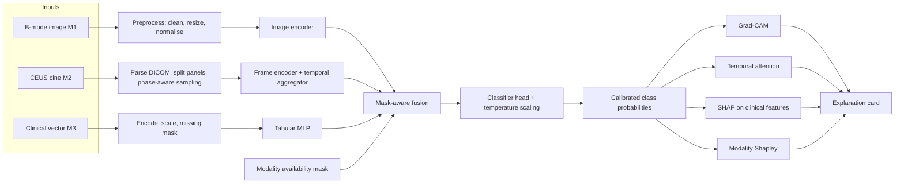

# XMAI: Explainable Multimodal AI for Differential Diagnosis of Focal Liver Lesions

## Design Document, Version 2.0 (Revised Build Specification)

| | |
|---|---|
| **Course** | Multimodal AI Lab, Mini Project, B.Tech. Artificial Intelligence & Machine Learning |
| **Institute** | Symbiosis Institute of Technology, Pune (Pune - 412115, Maharashtra, India), AY 2026-27 |
| **Group** | 14 |
| **Guide** | Dr. Nivedita Mishra |
| **Version / date** | 2.0 / 18 October 2026 |
| **Supersedes** | v1.0 "Consolidated Design Document" (merged from Initial Report, CA2, CA3, CA4) |
| **Status** | Draft for team decision. Items tagged `[OPEN]` need a decision before coding. |

### Team

| Member | ID | Role |
|---|---|---|
| Eric Siqueira | 23070126041 | Imaging data and preprocessing (Project Lead) |
| Ameya Tipnis | 23070126012 | Multimodal modelling and documentation |
| Asho Thekkeparampil | 23070126023 | Clinical data and evaluation |
| Bhoomika Kapde | 23070126025 | Explainability and dataset analysis |

### Evidence tags used in this document

| Tag | Meaning |
|---|---|
| `[V]` | Verified against the primary data or paper during the v2 audit (18 Oct 2026) |
| `[SRC]` | Carried from the team's earlier documents (IR, CA2, CA3, CA4) and not independently re-verified |
| `[DESIGN]` | Proposal introduced in v2. Safe to reject or tune |
| `[VERIFY]` | A fact that must be checked on the downloaded files before it is relied on |
| `[OPEN]` | Unresolved team decision |

### What changed from v1.0 and why

| # | Change | Reason |
|---|---|---|
| 1 | The five-class label space (HCC, hemangioma, FNH, metastasis, cyst) is withdrawn. Targets are now defined per experimental track. | The TCIA reference spreadsheet contains 107 HCC patients out of 120 and no hemangioma, FNH, metastasis or cyst labels (Section 5.1). v1's class table cannot be reproduced from the public file. |
| 2 | A single-dataset design is replaced by a multi-source, track-based design in which each track uses the modalities its dataset actually supports. | No open dataset supplies B-mode, CEUS video, structured clinical context and a multiclass reference standard together (Section 4.3). |
| 3 | The multimodal framework is now a first-class chapter (Section 4) and drives the architecture (Section 7), explainability (Section 8) and evaluation (Section 9). | The multimodal contribution was implicit in v1. |
| 4 | Clinical context is sourced from SMC-LUD (age, sex). TACE response, tumour stage and tumour size are excluded as leakage. | Section 5.6. |
| 5 | v1 Section 10 results are moved to Appendix A and marked withdrawn pending provenance. | They cannot be tied to the audited data. |
| 6 | Evaluation uses patient-level repeated cross-validation, confidence intervals and control experiments. | Cohorts are small and one dataset is near ceiling. |
| 7 | The schedule is compressed to the remaining window (18-21 Oct) with explicit cut lines. | Section 11. |

---

## 1. Executive summary

**Purpose.** XMAI investigates whether an explainable multimodal model that combines ultrasound morphology, contrast-enhanced ultrasound (CEUS) kinetics and structured patient context can support differential diagnosis of focal liver lesions (FLLs), and whether each modality's contribution can be explained to a clinician.

**Design in one paragraph.** XMAI uses modality-specific encoders (B-mode image, CEUS cine sequence, structured clinical vector) whose embeddings are combined by a mask-aware fusion module. An availability mask lets the same model operate when a modality is absent, which is the normal situation across public datasets. Explanations are produced for each modality (Grad-CAM for where, temporal attention for when, SHAP for which patient factor) and across modalities (exact Shapley values over modality coalitions for how much each modality mattered).

**Key decisions in v2**

1. Three experimental tracks replace one pooled five-class task (Section 6).
2. The patient-context hypothesis is tested where context actually exists: SMC-LUD, HCC versus hemangioma, age and sex only.
3. The temporal CEUS hypothesis is tested on SYSU-CEUS (HCC, hemangioma, FNH) if access is granted; otherwise CEUS is demonstrated as a pipeline on TCIA without a classification claim.
4. TCIA is used as an external, single-scanner check and as the CEUS preprocessing testbed, not as a multiclass training set.
5. Every reported number carries a sample size and a patient-level confidence interval. Null results are acceptable and reportable.

**What this project can and cannot claim**

| Claim | Supported? | Basis |
|---|---|---|
| A working explainable multimodal pipeline (image + context, optional CEUS) | Yes | Section 7, 8 |
| Image + age/sex changes performance relative to image-only on HCC vs hemangioma | Testable (exploratory) | Track A |
| Temporal CEUS adds information over single-phase or pooled views | Testable if SYSU-CEUS access is granted | Track B |
| Context "rescues" ambiguous cases in a five-class setting | No | No open data supports it |
| Clinical validity or diagnostic utility | No | Public retrospective data, small cohorts, selection effects |

---

## 2. Problem, research questions and hypotheses

### 2.1 Problem `[SRC: IR]`
B-mode ultrasound and CEUS interpretation depends on operator experience, and lesion types overlap visually (for example atypical HCC versus FNH or hemangioma). Published systems mostly address benign-versus-malignant classification and treat imaging as the primary or only input. The aim is not to replace clinical judgement but to study whether multimodal AI gives more useful and more transparent decision support than an image-only classifier.

### 2.2 Research questions

| ID | Question | Track |
|---|---|---|
| RQ1 | Does patient context (age, sex) improve HCC vs hemangioma discrimination beyond B-mode alone, particularly for low-confidence cases? | A |
| RQ2 | Does the temporal structure of CEUS carry information beyond a pooled or single-phase view? | B (C as pipeline demo) |
| RQ3 | Can explanations be made modality-aware: where (spatial), when (temporal), which patient factor, and how much each modality contributed? | A, B, C |
| RQ4 | How well do models transfer to an external, single-scanner cohort, and do they degrade gracefully when a modality is missing? | A to C |

### 2.3 Hypotheses with pre-specified decision rules `[DESIGN]`

| ID | Hypothesis | Decision rule |
|---|---|---|
| H1 | On the low-margin subset of Track A, image + context has lower log-loss than image-only. | Paired patient-level bootstrap 95% CI of the difference excludes 0 |
| H2 | Temporal CEUS aggregation outperforms mean-pooled frames and arterial-phase-only input. | Paired bootstrap CI on macro-F1 difference excludes 0 |
| H3 | A fusion model trained with modality dropout, evaluated with one modality removed, performs within the CI of the matching unimodal model. | Overlap of 95% CIs |
| H4 | Any gain from fusion is not explained by the context variables acting as noise or regularisation. | Gain disappears under the context-shuffle control (Section 9.3) |

If H1 fails, that is reported as a finding: on this cohort, age and sex add no information beyond B-mode.

---

## 3. Scope

**In scope:** HCC vs hemangioma on B-mode with age and sex (Track A); HCC, hemangioma and FNH on CEUS video (Track B, conditional); external HCC sensitivity and CEUS parsing on TCIA (Track C); modality-aware explanations; patient-level evaluation.

**Out of scope for this iteration:** cyst and metastasis classes (no verifiable open source); AFP, hepatitis and cirrhosis as inputs (not present in any audited open dataset); treatment-response prediction (a different, post-treatment task); any clinical deployment claim.

---

## 4. The multimodal framework

### 4.1 Rationale
A sonographer does not read a lesion from pixels alone. Three information streams are integrated: **morphology** (shape, margin, echotexture on B-mode), **kinetics** (how the lesion enhances and washes out over time on CEUS), and **context** (age, sex, liver disease history). The project's premise `[SRC: IR]` is that an image-only model is asked to decide with less information than the clinician has. XMAI makes each stream an explicit, separately inspectable modality.

### 4.2 Modality inventory

| ID | Modality | Nature | Information carried | Representation | Encoder (output) |
|---|---|---|---|---|---|
| M1 | B-mode ultrasound | 2-D grayscale image | Spatial morphology: boundary, echogenicity, texture, surrounding tissue | Tensor `[3,224,224]` | ResNet / ViT, fine-tuned (`z_B` ∈ R^256) |
| M2 | CEUS cine | Image sequence over time | Enhancement kinetics across arterial (~15 s), portal venous (~60 s) and late (~120 s) phases `[SRC: CA2]` | Tensor `[T,3,224,224]` with timestamps | Shared frame encoder + temporal aggregator (`z_C` ∈ R^256) |
| M3 | Structured clinical context | Tabular | Age, sex (and any confirmed field) with per-field missingness | Vector + missing mask | Small MLP (`z_T` ∈ R^64) |
| M4 (optional) | Clinical narrative text | Free text | History and findings in case reports | Token sequence | Extraction to M3 fields; not part of the MVP |

### 4.3 Dataset, modality and task coverage `[V]`

| Dataset | M1 B-mode | M2 CEUS | M3 context | Labels | Scale | Role in XMAI |
|---|---|---|---|---|---|---|
| SMC-LUD | Yes | No | Age, sex (per-row availability `[VERIFY]`); T-stage and size for HCC only | HCC, hemangioma | 5,385 images, 1,021 patients | Track A (primary) |
| SYSU-CEUS | Possibly within videos `[OPEN]` | Yes | None | HCC, hemangioma, FNH | 353 lesions (186 / 109 / 58) | Track B (conditional on access) |
| TCIA B-mode-and-CEUS-Liver | Yes | Yes (67 multi-frame series) | None usable (diagnosis, TACE response only) | 107 HCC of 120; no hemangioma, FNH, metastasis, cyst | 120 patients | Track C |
| AUL | Yes | No | None | Benign / malignant / normal, plus masks | 735 images | Optional lesion localiser |
| MultiCaRe | Case-report figures | No | Narrative text | Weak, caption-derived | 130k+ images | Optional M4 |
| MedPix 2.0 | Mixed | No | Narrative text | Teaching cases | Large, mostly CT/MR | Excluded (licence, modality mix) |

**Consequence:** no dataset provides all modalities. The architecture is therefore **mask-aware by construction**, and cross-track results are never pooled into one metric.

### 4.4 Cross-modal relationships the design must expose `[DESIGN]`

| Relationship | Example | What the system must show |
|---|---|---|
| Complementary | B-mode: FNH can resemble normal liver; CEUS: strong arterial enhancement, sometimes with a central scar `[SRC: CA3]` | Per-modality contributions disagree in direction but agree after fusion |
| Context-conditioned | In SMC-LUD, HCC patients are older (mean 66.65 vs 55.50 years) and more often male (81.8% vs 41.3%) `[V]` | A cohort prior, not a causal feature. Explanations must say so |
| Conflicting | Image evidence and context point to different classes | Flag for review instead of silently averaging |
| Redundant | CEUS and B-mode both indicate the same lesion | Shapley shares credit; ablations reveal redundancy |

### 4.5 Design principles
1. **P1** Modality-specific encoders are preserved, so each modality can be evaluated and explained alone.
2. **P2** Availability is explicit. A mask enters the fusion module and the evaluation protocol.
3. **P3** Every modality must earn its place through ablation and the context-shuffle control.
4. **P4** The patient is the unit of analysis for splits, statistics and error counting.
5. **P5** No feature unavailable at diagnosis time and no feature that encodes the label is allowed as input.
6. **P6** Explanations are model-faithful descriptions, never clinical evidence.

---

## 5. Data audit (verified 18 October 2026)

### 5.1 TCIA B-mode-and-CEUS-Liver `[V]`
Source files audited: the DICOM series metadata export and `B-mode-and-CEUS-Liver_ReferenceStandards_v2_20220218.xlsx`. All 120 patient IDs match across both files. The harmonised label file is `tcia_labels_harmonized.csv`.

| Harmonised diagnosis | Patients | Notes |
|---|---|---|
| HCC (single lesion) | 107 | 89% of the cohort |
| Indeterminate (LI-RADS 3, 4, NC) | 4 | Reference not established |
| Intrahepatic cholangiocarcinoma | 3 | Includes one "favouring ICC on explant pathology" |
| Benign, unspecified | 3 | |
| Benign, abscess | 1 | |
| Mixed two-lesion patients | 2 | HCC + indeterminate; benign + HCC. Excluded from single-label analyses |

- The spreadsheet has four columns only: patient ID, collection name, final diagnosis, "Complete Response to TACE?".
- No hemangioma, FNH, metastasis or cyst label exists.
- TACE response is populated for 59 patients, all HCC (21 complete, 38 incomplete).
- DICOM headers: 67 multi-frame ultrasound series, 39 Secondary Capture series (mostly 2012-2013), 14 single-frame series.
- Every series is from one scanner model (GE LOGIQ E9). Studies span 2004-2015, with a small 2004-2005 group.
- Age is present for 9 of 120 patients and a real sex value (M/F) for 12 of 120. Sex "O" (75) is a DICOM placeholder.
- Patient IDs run to LiverUS-126 with six gaps. Joins must use the ID string.

### 5.2 SMC-LUD `[V]`
- Samsung Medical Center, Scientific Data (2026): 5,385 B-mode images from 1,021 patients, HCC versus hemangioma. Licence CC BY-NC-ND, non-commercial research use.
- Published baseline: 98.88% accuracy on 268 test images (140 HCC, 128 hemangioma), about 3 errors. An independent paper reports about 98.5% on the same data. Image-only performance is therefore near ceiling on typical cases.
- Metadata: T-stage and tumour size exist **for HCC only**, which makes them label-leaking. Age and sex are summarised in the paper; per-row availability `[VERIFY]`.
- Authors excluded caliper-marked images to avoid spurious cues. Use the Clean version.
- Consistency check `[VERIFY]`: the paper describes one representative image per HCC case, yet reports 2,716 HCC images against 1,021 patients in total. Count images per patient before splitting.
- The ND clause restricts sharing adapted material. Do not redistribute resized or cropped images.

### 5.3 SYSU-CEUS `[V]`
- 353 instances: 186 HCC, 109 hemangioma, 58 FNH (186 malignant, 167 benign). Only a small sample is in the public repository; the full set is obtained by request for academic use. No clinical data.
- Whether B-mode appears alongside CEUS in each video `[OPEN]`.

### 5.4 AUL `[V]`
- 735 images: 435 malignant, 200 benign, 100 normal, with liver and lesion masks. No lesion subtype, no clinical data. Use as a localiser or pretraining source only.

### 5.5 MultiCaRe and MedPix `[V]`
- MultiCaRe: open-access PMC case reports, CC BY-NC-SA overall with some less restrictive files. Image labels are caption-derived and noisy. Optional source for M4 only.
- MedPix 2.0: licence limits reuse to personal and teaching use and the image mix is mostly CT/MR. Excluded from modelling.

### 5.6 Leakage register `[V]` / `[DESIGN]`

| Field or signal | Where | Why excluded | Control |
|---|---|---|---|
| TACE response | TCIA | Populated only for HCC; known only after treatment | Not in any feature list |
| Tumour T-stage and size | SMC-LUD | HCC only, so presence alone reveals the class | Not in any feature list |
| Acquisition format, year, file size, frame count | TCIA | Correlated with each other; may correlate with diagnosis | Shortcut-baseline test (Section 9.4) |
| Dual-panel layout | TCIA | A "B-mode only" input may contain the CEUS panel | Panel split before any B-mode use |
| Caliper and annotation marks | SMC-LUD | Spurious cue | Use Clean images |
| Patient identifiers | All | Identify the patient, not the lesion | Used only to join and split |

An automated assertion in the data loader fails the run if any excluded field name appears in a feature list.

---

## 6. Experimental design

### 6.1 Tracks

| Track | Question | Modalities | Dataset | Labels | Status |
|---|---|---|---|---|---|
| A: Context | RQ1, H1, H4 | M1 (+ M3: age, sex) | SMC-LUD | HCC vs hemangioma (K=2) | **MVP** |
| B: Temporal | RQ2, H2 | M2 (+ M1 if present) | SYSU-CEUS | HCC, hemangioma, FNH (K=3) | Conditional on access |
| C: External and pipeline | RQ4 | M1, M2 | TCIA | Not trained on. External HCC sensitivity and descriptive behaviour only | **MVP** (pipeline) |
| D: Narrative | RQ3 extension | M4 to M3 | MultiCaRe | None | Stretch, likely deferred |

### 6.2 Splits and sample sizes
- Patient-level stratified 5-fold cross-validation, repeated twice with different seeds. A validation fold inside each training fold drives early stopping and temperature scaling.
- The official SMC-LUD test split, if shipped, is used once as a sanity check, not for model selection.
- Track C: never used for training. Report HCC sensitivity on 107 patients with a Wilson 95% interval. For the 7 definitive non-HCC patients (3 ICC, 4 benign) show per-patient predictions only; no class metrics.

### 6.3 Defining "ambiguous" `[DESIGN]`
The v1 definition ("image-only fails, multimodal succeeds") is outcome-dependent and cannot be applied before seeing the label. XMAI uses two separate sets built from out-of-fold image-only predictions:

1. **Low-margin set:** lowest decile of the top-2 probability margin (pre-specified, not tuned).
2. **Error set:** all image-only errors.

Because SMC-LUD is near ceiling, the error set will be small. The low-margin set is the primary analysis for H1 and the error set is reported with exact counts.

---

## 7. System architecture

### 7.1 Pipeline



### 7.2 Preprocessing per modality `[DESIGN]`

| Modality | Steps |
|---|---|
| M1 B-mode | Use Clean (no calipers) images; crop non-image margins; resize to 224x224; replicate to 3 channels; ImageNet normalisation. Training-only augmentation: horizontal flip, rotation up to 10 degrees, brightness/contrast jitter. |
| M2 CEUS | Read DICOM multi-frame objects; derive frame timestamps from `FrameTime` or `CineRate` `[VERIFY]`; detect and split dual-panel frames into B-mode and CEUS halves; sample T=16 frames by phase windows (arterial, portal venous, late) so that near-duplicate frames are avoided; resize and normalise as for M1. |
| M3 Clinical | Age: z-score fitted on the training fold only. Sex: binary. One missing-indicator per field. No identifiers, no excluded fields (Section 5.6). |

### 7.3 Tensor interface

| Name | Shape | Description |
|---|---|---|
| `img` | `[B,3,224,224]` | B-mode frame |
| `ceus` | `[B,T,3,224,224]`, `T=16` | CEUS frames with `ceus_t` timestamps `[B,T]` |
| `clin` / `clin_miss` | `[B,d_c]` / `[B,d_c]` | Clinical vector and per-field missing flags |
| `mod_mask` | `[B,3]` | 1 if modality M1, M2, M3 is present for the sample |
| `z_B`, `z_C`, `z_T` | `[B,256]`, `[B,256]`, `[B,64]` | Modality embeddings |
| `logits` | `[B,K]` | K=2 (Track A), K=3 (Track B) |

### 7.4 Encoders
- **M1:** ResNet-18/50 (ImageNet) as baseline; ViT-B/16 as comparison `[SRC]`. Embedding via a linear projection to 256.
- **M2:** the M1 backbone applied per frame (weights shared), then one of three aggregators evaluated as an ablation: (a) mean pooling, (b) temporal attention pooling, (c) BiLSTM. The attention weights double as the temporal explanation.
- **M3:** two-layer MLP (64 units, dropout 0.3).

### 7.5 Fusion family

| ID | Fusion | Mechanism | Strength | Weakness | Explainability |
|---|---|---|---|---|---|
| F0 | Early | Clinical vector injected at input or shallow-feature level of the image network | Can learn low-level interactions | Low-dimensional clinical data is swamped; overfits with few subjects `[SRC: CA4]` | Hardest to separate by modality |
| F1 | Late | Separately trained unimodal models; probabilities combined by weighted average or stacking | Robust; tolerant of a missing modality | No interaction modelling | Simple per-branch attribution |
| F2 | Hybrid-concat | `[z_B; z_C; z_T]` to MLP head (v1's "hybrid") | Simple joint model | Needs all embeddings unless trained with dropout | Post-hoc only |
| F3 | Hybrid-gated | Gate `g = softmax(W[z_B;z_C;z_T])` renormalised over present modalities; `z_f = sum_m g_m P_m z_m` | Gate weights are a built-in modality-importance readout | More parameters | Per-sample modality weights plus Shapley |
| F4 | Hybrid-FiLM | Clinical vector conditions the image embedding: `z_B' = gamma(z_T) * z_B + beta(z_T)` | Context modulates how image evidence is read, which matches the clinical rationale | Highest overfitting risk with tiny context vectors | Gamma and beta inspectable |

**Interaction test:** if F1 (additive in probability space) and F2 to F4 (interactive) perform equally, the data show no cross-modal interaction beyond additive evidence. This is a reportable finding.

**Primary model:** F3 for Track A and B. F0 to F2 and F4 are reported as comparisons under identical splits.

### 7.6 Missing-modality handling `[DESIGN]`
This resolves v1 issue F8 (embedding fusion needs both inputs).
- Training: independent modality dropout (p=0.2 per modality, never all three), so the model sees absent inputs.
- Inference: an absent modality gets a learned null embedding and its gate logit is masked before the softmax.
- Evaluation: every fusion model is scored with each modality removed (H3).

### 7.7 Training protocol `[DESIGN]`

| Item | Default |
|---|---|
| Loss | Class-weighted cross-entropy, light label smoothing (0.05) |
| Optimiser | AdamW; learning rate 1e-4 backbone, 1e-3 heads; weight decay 1e-2; cosine schedule |
| Batch size | 32 (B-mode), 4 to 8 (CEUS) |
| Epochs / stopping | Up to 30; early stopping on validation log-loss, patience 5 |
| Calibration | Temperature scaling on the validation fold |
| Seeds | 5 seeds per configuration; report mean and SD across seeds and folds |
| Reproducibility | Fixed seeds, deterministic flags, config files committed with results |

Hyperparameters are defaults, not tuned values. With small cohorts, tuning on the evaluation folds would inflate results; tune only inside the training folds.

---

## 8. Explainability architecture

### 8.1 One question per modality, plus cross-modal questions

| Scope | Question | Method | Output | Validation |
|---|---|---|---|---|
| M1 | Where in the image? | Grad-CAM on the last convolutional block (ResNet); attention rollout for ViT | Heatmap overlay | Deletion/insertion curves; model-randomisation sanity check |
| M2 | When, and where? | Temporal attention weights aggregated per phase; Grad-CAM on the top-k frames | Phase-importance bar plus key frames | Phase-masking test: removing the top phase should reduce the predicted class probability |
| M3 | Which patient factor? | SHAP over clinical features with the image embedding held fixed per patient | Bar or waterfall plot | Context-shuffle control (Section 9.3) |
| Cross-modal | How much did each modality matter? | Exact Shapley values over the 2^3 modality coalitions, computed by masking (at most 8 forward passes) | Per-patient modality contribution bar | Agreement with gate weights (F3) |
| Disagreement | Why did fusion differ from image-only? | Compare the above for image-only and fused models | Explanation card for every rescue and harm case | Manual review by the team against imaging priors |

### 8.2 Explanation card (one per reviewed patient)
1. Calibrated probabilities for image-only and fused models, with the top-2 margin.
2. Grad-CAM overlay (B-mode) and, if present, key CEUS frames with phase-importance bar.
3. SHAP bars for age and sex, with a note that these reflect cohort statistics.
4. Modality Shapley bar.
5. Warning flags: low margin, modality missing, out-of-distribution score high, image-context conflict.

### 8.3 Imaging priors for sanity checks `[SRC: CA3 3.2]`
Heatmaps should be checked against these expectations. A model whose attention falls outside the lesion or on annotation marks fails the check.

- **Hemangioma:** well-defined, homogeneously hyperechoic on B-mode; CEUS shows peripheral nodular enhancement in arterial phase with slow, centripetal fill-in.
- **FNH:** usually resembles normal liver tissue on B-mode; on CEUS shows striking arterial-phase enhancement, even with a central scar.
- **HCC:** varied B-mode echogenicity; CEUS shows typical perfusion changes in arterial and portal-venous/later phases.
- CEUS phases in CA2 Fig 1: arterial (~15 s), portal venous (~60 s), late (~120 s). `[SRC: CA2]`

Cyst and metastasis priors are omitted because those classes are out of scope in v2.

### 8.4 Limits
Grad-CAM and SHAP describe what the model used, not what is clinically causal. Age and sex effects in SMC-LUD reflect referral and selection patterns. Explanation outputs are shown as descriptive material and never as diagnostic evidence.

---

## 9. Evaluation plan

### 9.1 Metrics
- Accuracy, balanced accuracy, per-class precision, recall (sensitivity), specificity and F1, macro one-vs-rest AUC (Track B), AUC (Track A).
- Probabilistic quality: log-loss, Brier score, expected calibration error (10 bins).
- Counts: patients per class in each fold, so that every percentage can be traced to integers.
- Uncertainty: patient-level bootstrap (2,000 resamples) for all intervals; paired bootstrap for model comparisons.

### 9.2 Ablation matrix

| ID | Track | Inputs | Fusion | Purpose |
|---|---|---|---|---|
| A1 | A | M1 | none | Image-only baseline |
| A2 | A | M3 | none | Age/sex-only baseline (strength of the cohort prior) |
| A3 | A | M1 + M3 | F2 | Concatenation |
| A4 | A | M1 + M3 | F3 | Primary model |
| A5 | A | M1 + M3 | F4 | Context-conditioned image reading |
| A6 | A | M1 + M3 | F1 | Additive late fusion (interaction test) |
| A7 | A | M1 + shuffled M3 | F3 | Context-shuffle control |
| B1 to B4 | B | M2 | aggregator: mean / attention / BiLSTM / arterial-only | Temporal modality value (H2) |
| C1 | C | M1, M2 | models from A and B | External sensitivity and behaviour |

### 9.3 Complementarity analysis and controls
- **Rescue / harm / net:** image-only errors corrected by fusion, image-only correct cases broken by fusion, net gain, and both-wrong. Counts first, percentages second. Test with exact McNemar.
- **Oracle complementarity:** share of patients where at least one unimodal model is correct while the other is wrong.
- **Context-shuffle control (H4):** permute age and sex across patients within class-balanced strata and retrain. If the fusion gain persists, it is not coming from the context.
- **Interaction test:** A6 versus A3 to A5 (Section 7.5).

### 9.4 Robustness and shortcut tests
- **Missing modality (H3):** score A3 to A5 with M1 or M3 removed.
- **External check (RQ4):** apply Track A models to TCIA B-mode frames; report HCC sensitivity with a Wilson interval and per-patient outputs for the 7 definitive non-HCC patients.
- **Shortcut baseline:** train a trivial classifier on TCIA acquisition format, year, file size and frame count only, using the harmonised labels. A result clearly above the majority-class rate means B-mode inputs are contaminated by acquisition style.
- **Perturbation:** brightness, noise and mild blur at three levels, to measure stability of both predictions and heatmaps.

### 9.5 Reporting templates

**Template A: model comparison (per track)**

| Model | Inputs | n patients | Balanced acc. (95% CI) | AUC (95% CI) | Log-loss (95% CI) | ECE |
|---|---|---|---|---|---|---|

**Template B: per-class (Track B)**

| Class | n | Precision | Recall | Specificity | F1 | AUC |
|---|---|---|---|---|---|---|

**Template C: rescue and harm**

| Subset | n patients | Image-only errors | Rescued | Harmed | Both wrong | Net gain | McNemar p |
|---|---|---|---|---|---|---|---|

**Template D: patient-level output.** Class probabilities for each model must sum to 1.000 (assertion in code), followed by prediction, true label, margin and flags.

### 9.6 Acceptance criteria
- Every reported metric states n and a 95% CI.
- No patient appears in more than one partition (asserted).
- No excluded field appears in a feature list (asserted).
- Each fusion claim is accompanied by its unimodal baseline, trained on identical splits.
- A negative or null result is reported with the same prominence as a positive one.

---

## 10. Risk register

| Risk | Impact | Mitigation |
|---|---|---|
| SMC-LUD near ceiling (about 98.5% image-only) | Few errors, little room for context to help | Low-margin set as primary analysis; report null results; pre-specified H1 rule |
| Cohort-specific age/sex priors | Context "helps" for the wrong reason | A2 baseline, shuffle control (A7), explicit caveat in explanations |
| Label-leaking fields | Inflated results | Leakage register, automated assertions (Section 5.6) |
| Possible multiple images per patient in SMC-LUD | Patient-level leakage in splits | Count images per patient first; split by patient ID |
| Acquisition shortcuts in TCIA (format, year, dual-panel) | Spurious accuracy | Shortcut baseline; panel split; year as a stratification diagnostic |
| Single-scanner TCIA | No scanner-generalisation claim possible within TCIA | State explicitly; only cross-dataset transfer addresses site shift |
| SYSU-CEUS access delayed | Track B unavailable | Decision gate; fall back to a pipeline demonstration on TCIA without a classification claim |
| Very small cohorts (TCIA non-HCC n=7) | Meaningless class metrics | Descriptive reporting only |
| CEUS temporal variability | Inconsistent sampling | Phase-aware sampling; timestamps from DICOM |
| Licences (NC, ND, SA) | Redistribution violations | No redistribution of images; cite and attribute; course use only |
| Time (3 days to the planned final window) | Incomplete deliverables | MVP and cut lines (Section 11) |
| Over-interpretation | Misleading clinical claims | Scope statement (Section 1), limits (Section 8.4) |

---

## 11. Compressed plan (18 to 21 October 2026)

The original timeline `[SRC: IR]` placed the prototype at 12-18 Oct and final deployment, results and documentation at 19-21 Oct. The plan below fits the remaining window.

| Day | Work | Owner (by role) | Deliverable |
|---|---|---|---|
| 18 Oct | Freeze label spec and leakage register; build patient manifest for SMC-LUD and TCIA; check images per patient and per-row age/sex in SMC-LUD; email SYSU-CEUS authors | Imaging data (lead), Clinical data | Manifest, audit notes, access request sent |
| 19 Oct | Track A baselines A1, A2 and fusion A3 to A6 with CV; TCIA DICOM parsing and panel split; Track B decision gate at 12:00 | Modelling, Imaging data | CV results (preliminary), parsed TCIA frames |
| 20 Oct | A7 shuffle control; external check on TCIA; Grad-CAM, SHAP, modality Shapley; Track B if access granted | Explainability, Evaluation | Explanation cards, Templates A, C |
| 21 Oct | Statistics, figures, final report and presentation | All | Final report |

**Cut lines (drop in this order if time runs out):** Track B, F4, ViT comparison, perturbation tests, BiLSTM aggregator. **Never cut:** patient-level splits, leakage assertions, A1/A2/A4/A7, confidence intervals.

---

## 12. Definition of done

- [ ] Manifest with patient ID, paths, label, fold, and modality availability for each dataset used
- [ ] Track A ablations A1 to A7 complete with 95% CIs and calibration
- [ ] Rescue/harm table with exact counts for low-margin and error sets
- [ ] Explanation cards for at least 5 rescue or harm cases (or all, if fewer)
- [ ] External TCIA check reported with Wilson interval and descriptive non-HCC outputs
- [ ] Shortcut baseline reported
- [ ] Track B reported, or an explicit statement that access was not obtained
- [ ] Appendix A results either reproduced from code with provenance or removed from the report

### Pre-coding checklist
- [ ] Per-row age and sex exist in the SMC-LUD CSV; images per patient counted
- [ ] SYSU-CEUS access request sent; B-mode presence in videos checked on arrival
- [ ] `FrameTime` or `CineRate` available in TCIA multi-frame DICOMs
- [ ] Split protocol and seeds fixed in a config file
- [ ] Threshold for the low-margin set fixed (lowest decile) before any model comparison

---

## 13. Validation log (v1 issues and v2 status)

| v1 ID | Finding in v1 | Evidence from audit | v2 status |
|---|---|---|---|
| F1 | Cyst class had no data source | No cyst, hemangioma, FNH or metastasis labels in the TCIA spreadsheet; 107 of 120 are HCC | Resolved by redesign (Section 6) |
| F2 | Clinical features contradicted across documents | Spreadsheet has four columns; DICOM age 9/120, sex 12/120 | Resolved: clinical modality sourced from SMC-LUD |
| F3 | Probable leakage in the clinical branch | TACE response exists only for HCC | Mitigated (Section 5.6) |
| F4 | Provenance of v1 results unclear | Class table not reproducible from the public file | **Open:** team to state how Appendix A numbers were produced |
| F5 | Test-set size not reported | | Addressed by CV, counts and CIs |
| F6 | Patient-level probabilities did not sum to 100% | | Addressed by Template D assertion |
| F7 | No harm counterpart to the rescue rate | | Addressed by Template C |
| F8 | Missing-modality claim conflicted with fusion design | | Addressed by Section 7.6 |
| F9 | Hybrid fusion "expected to lead" untested | | Treated as a hypothesis; ablations A3 to A6 |
| F10 | Single run, high variance | | Five seeds, repeated CV |
| F11 | Dual-panel leakage | 39 Secondary Capture series | Panel split required |
| F12 | Frame aggregation unspecified | | Aggregator ablation B1 to B4 |
| F13 to F15 | Table error, editorial leftovers, uninformative figure | | Removed in v2; replace the figure with an actual Grad-CAM output |

**New findings in v2**

| ID | Finding |
|---|---|
| N1 | TCIA is a single-scanner dataset (GE LOGIQ E9), so scanner variability cannot be studied inside it |
| N2 | TCIA contains two time cohorts (2004-2005 and 2011-2015), a possible batch effect |
| N3 | SMC-LUD staging and size fields exist for HCC only |
| N4 | SMC-LUD describes one image per HCC case but reports 2,716 HCC images from 1,021 patients; `[VERIFY]` |
| N5 | SMC-LUD is near ceiling for image-only classification |
| N6 | No open dataset audited provides multiclass FLL ultrasound with per-patient clinical context |

---

## Appendix A: Legacy provisional results from v1 (withdrawn)

> **Status: withdrawn.** The numbers below come from the earlier documents. They were produced on a five-class label set that cannot be reproduced from the public TCIA reference file (Section 5.1), and their provenance is unresolved (F4). They must not appear in the final report as findings unless the team can reproduce them from code and data with a documented label mapping.

Context `[SRC: CA3 3.3]`: "provisional web-scraped cohort (N=120)". Targets were "calibrated conservatively" for a five-way task and "a restricted cohort size with sparse clinical inputs."

### A.1 Branch results `[SRC: CA3 Table 2, CA4 4.1]`

| Evaluation branch | Projected target (5-class, small cohort) | Initial result | Notes |
|---|---|---|---|
| Image-only (B-mode) | Acc. 55-65% | Acc. 58.3% | Target met; baseline bounded by initial web-scraped resolution |
| Image-only (B-mode+CEUS) | Acc. 65-75% | Acc. 67.1% | Target met; validates the diagnostic utility of contrast-enhanced data |
| Clinical-only | Acc. 35-45% | Acc. 38.5% | Target met; weak independently due to limited feature availability |
| Multimodal fusion | Acc. 70-80%, AUC 0.80-0.88 | Acc. 72.4%, AUC 0.81 | Target achieved |
| Ambiguous-case rescue | Recover ≥ 20-30% of errors | 22.5% rescue rate | Target achieved |

- "improvement of 5.3 points over the best image-only model" `[SRC: CA4]`

### A.2 Per-class, hybrid fusion `[SRC: CA4 4.2]`

| Lesion Type | Precision | Recall | F1-Score | Specificity | AUC-ROC |
|---|---|---|---|---|---|
| HCC | 0.72 | 0.69 | 0.70 | 0.78 | 0.79 |
| Hemangioma | 0.75 | 0.78 | 0.76 | 0.81 | 0.82 |
| FNH | 0.68 | 0.65 | 0.66 | 0.84 | 0.77 |
| Metastasis | 0.71 | 0.66 | 0.68 | 0.79 | 0.76 |
| Cyst | 0.85 | 0.87 | 0.86 | 0.88 | 0.89 |
| Macro Average | 0.74 | 0.73 | 0.73 | 0.82 | 0.81 |

- Cysts most separable (anechoic B-mode appearance). FNH and metastasis weakest, "in line with the literature on overlapping enhancement patterns."

### A.3 Patient-level predictions `[SRC: CA4 4.3]`

| Patient ID | Model | HCC | Hemangioma | FNH | Metastasis | Cyst | Prediction | True Label |
|---|---|---|---|---|---|---|---|---|
| PT-001 | Image-only (uncertain) | 42.1% | 45.8% | 2.1% | 8.2% | 1.8% | Hemangioma | HCC |
| PT-001 | Multimodal (fused) | 48.4% | 38.2% | 2.5% | 8.9% | 2.0% | HCC | HCC |
| PT-002 | Multimodal (fused) | 4.2% | 48.5% | 4.4% | 1.4% | 5.5% | Hemangioma | Hemangioma |
| PT-003 | Multimodal (fused) | 5.5% | 3.8% | 47.2% | 7.4% | 5.1% | FNH | FNH |
| PT-004 | Multimodal (fused) | 18.8% | 2.5% | 3.9% | 42.3% | 2.5% | Metastasis | Metastasis |
| PT-005 | Multimodal (fused) | 1.1% | 2.8% | 1.2% | 1.4% | 43.5% | Cyst | Cyst |

`[FLAG]` Rows PT-002 to PT-005 do not sum to 100%. See F6.

---

## Appendix B: Literature baseline `[SRC: IR, Table 1]`

| Ref | Authors, year | Data | Key result | Gap relevant to XMAI |
|---|---|---|---|---|
| [1] | Schmauch et al., 2019 | 367 2-D US images dev; independent 177 patients | ROC-AUC 0.935 detection, 0.916 characterization | Small dev set, image-only, no clinical context |
| [2] | Yang et al., 2020 | 24,343 images, 2,143 patients, 13 hospitals | External AUC 0.924; exceeded highly experienced radiologists in reported comparison | Binary benign/malignant |
| [3] | Tiyarattanachai et al., 2021 | 40,397 images, 3,487 patients | High specificity; HCC, cysts, hemangiomas identified | No patient context |
| [4] | Tiyarattanachai et al., 2022 | 446 videos, 334 patients, >1.5 million frames | ~89.8% FLL detection, ~30-34 fps | Detection only |
| [5] | Căleanu et al., 2021 | CEUS: FNH, HCC, hemangioma, hyper/hypovascular metastases | ~88% accuracy across five FLL types; leave-one-patient-out + hard voting | Small data, no clinical info |
| [6] | Zhao et al., 2023 | Pooled multi-site CEUS | 88.64% benign/malignant; 91.27% HCC/ICC (ResNet-50 + HAE + NFA) | Binary tasks, no clinical data |
| [7] | Zhou et al., 2024 | 420 FLLs (136 benign, 284 malignant) | 2-D CNN + LSTM mean AUC ~0.91 vs 3-D CNN 0.88 vs TIC-based 0.78 | Binary, no clinical variables |
| [8] | Strohm et al., 2025 | Dynamic liver CEUS | ~82% balanced accuracy for washout classification | Predicts one CEUS trait only |
| [9] | Oezsoy et al., 2025 | 370 patients, 955,938 CEUS images | AUROC ~0.94; attention-based multiple-instance learning | Binary, no clinical variables |
| [10] | Ding et al., 2025 | 52 centres; CEUS videos + biomarkers + clinical; six FLL categories | Outperformed junior CEUS radiologists, approached senior CEUS/MRI readers | Proprietary data; no explicit context-rescue analysis |
| [11] | Liu et al., 2022 | 303 patients, three hospitals; CEUS + AFP + hepatitis | Full multimodal AUC 0.969 internal, 0.957 external (four 3-D CNN models) | Only AFP and hepatitis; binary |
| [12] | Li et al., 2021 | 226 lesions: 107 atypical HCC, 119 FNH | Ultrasomics AUC 0.86; combined 0.93 (3,132 features, SVM) | Only FNH vs atypical HCC |
| [13] | Turco et al., 2022 | Clinical CEUS, benign/malignant | Interpretable radiomics (perfusion, spatiotemporal, texture) | No clinical context in explanation |
| [14] | Mămuleanu et al., 2023 | 50 CEUS videos, 49 patients; age, gender, cirrhosis, hepatitis | NN combining clinical variables with time-intensity features (max intensity, AUC, mean transit time, time-to-peak) | Very small cohort, overfitting risk |
| [15] | Urhuț et al., 2023 | 49 patients, 59 tumours | AI vs clinicians on CEUS; multiclass harder than binary | Small sample; unequal context |
| [16] | Tangruangkiat et al., 2024 | 581 US images, five classes | Pretrained ResNet-50 ~87 ± 2.2% CV accuracy | No CEUS or clinical context |
| [17] | Shen et al., 2024 | Sonazoid CEUS + Sound Touch Elastography + clinical | Multimodality + clinical improved benign/malignant prediction | Binary; modalities may be unavailable publicly |
| [18] | Dadoun et al., 2022 | 2,551 B-mode images, 1,026 patients; test 155 images, 48 patients | DETR ~97% sensitivity, 90% specificity for detection | Characterization benign/malignant; clinical history unavailable. Relevance cell is blank in the source table. |
| [19] | Xu et al., 2026 | 687 patients (285 benign, 402 malignant) | ResNet-18 B-mode + CEUS fusion: AUC ~0.994, accuracy ~96.38% | Binary; clinical variables only as subgroups |
| [20] | Lingamaiah et al., 2026 | SYSU-FLLCEUS | DarkNet-19 + Bottleneck Attention Module + phase-aware frame selection; Grad-CAM | No clinical integration |

Review conclusion `[SRC: IR 5.2]`: the field is still mostly benign-vs-malignant; "Fine-grained differential diagnosis, transparent integration of clinical context and explicit evaluation of diagnostically ambiguous cases remain less extensively explored."

---

## Appendix C: Dataset access and licences

| Dataset | Access | Licence (as verified) |
|---|---|---|
| TCIA B-mode-and-CEUS-Liver | https://www.cancerimagingarchive.net/collection/b-mode-and-ceus-liver/ , DOI 10.7937/TCIA.2021.v4z7-tc39 | CC BY 4.0 `[SRC]` |
| SMC-LUD | https://www.nature.com/articles/s41597-026-07023-7 (data on Figshare) | CC BY-NC-ND, non-commercial |
| SYSU-CEUS | https://github.com/lemondan/Focal-liver-lesions-dataset-in-CEUS (full set by request) | Academic use on request |
| AUL | https://www.kaggle.com/datasets/orvile/annotated-ultrasound-liver-images-dataset | Open with attribution `[VERIFY]` on the download page |
| MultiCaRe | https://zenodo.org/records/10079370 (use the latest version) | CC BY-NC-SA overall; individual files vary |
| MedPix 2.0 | NIH/NLM MedPix | Personal and teaching use; excluded |

Independent replication of the SMC-LUD ceiling: SEED-Net, https://www.ncbi.nlm.nih.gov/pmc/articles/PMC13553492/

---

## Appendix D: Manifest schema and repository layout `[DESIGN]`

`manifest.csv` columns: `patient_id`, `dataset`, `track`, `label`, `fold`, `has_M1`, `has_M2`, `has_M3`, `path_M1`, `path_M2`, `age`, `sex`, `acq_format`, `study_year`.

```
xmai/
├─ configs/         per-track YAML (seeds, folds, hyperparameters)
├─ data/            raw files (not committed), manifest.csv, tcia_labels_harmonized.csv
├─ preprocess/      dicom_inspect, split_panels, ceus_phase_sampling, clinical_clean, leakage_assert
├─ models/          image_encoder, temporal_aggregator, clinical_encoder, fusion_{early,late,concat,gated,film}
├─ train/           cv_runner, modality_dropout, calibration
├─ eval/            metrics, bootstrap, rescue_harm, shuffle_control, shortcut_baseline
├─ explain/         gradcam, temporal_attention, shap_clinical, modality_shapley, explanation_card
└─ reports/         tables A to D, figures
```

---

## Appendix E: References `[SRC: IR]`

1. Schmauch B, et al. (2019). Diagnosis of focal liver lesions from ultrasound using deep learning. Diagnostic and Interventional Imaging, 100(4), 227-233. https://doi.org/10.1016/j.diii.2019.02.009
2. Yang Q, et al. (2020). Improving B-mode ultrasound diagnostic performance for focal liver lesions using deep learning: A multicentre study. EBioMedicine, 56, 102777. https://doi.org/10.1016/j.ebiom.2020.102777
3. Tiyarattanachai T, et al. (2021). Development and validation of artificial intelligence to detect and diagnose liver lesions from ultrasound images. PLoS ONE, 16(6), e0252882. https://doi.org/10.1371/journal.pone.0252882
4. Tiyarattanachai T, et al. (2022). The feasibility to use artificial intelligence to aid detecting focal liver lesions in real-time ultrasound: a preliminary study based on videos. Scientific Reports, 12(1), 7749. https://doi.org/10.1038/s41598-022-11506-z
5. Căleanu CD, Sîrbu CL, Simion G. (2021). Deep Neural Architectures for Contrast Enhanced Ultrasound (CEUS) Focal Liver Lesions Automated Diagnosis. Sensors, 21(12), 4126. https://doi.org/10.3390/s21124126
6. Zhao L, et al. (2023). A unified end-to-end classification model for focal liver lesions. Biomedical Signal Processing and Control, 86 Part B, 105260. https://doi.org/10.1016/j.bspc.2023.105260
7. Zhou H, Ding J, Zhou Y, et al. (2024). Malignancy diagnosis of liver lesion in contrast enhanced ultrasound using an end-to-end method based on deep learning. BMC Medical Imaging, 24, 68. https://doi.org/10.1186/s12880-024-01247-y
8. Strohm H, Rothlübbers S, Jenne J, et al. (2025). Deep-learning-based washout classification for decision support in contrast-enhanced ultrasound examinations of the liver. Journal of Medical Imaging, 12(4), 044502. https://doi.org/10.1117/1.JMI.12.4.044502
9. Oezsoy A, et al. (2025). Weakly Supervised Deep Learning Can Analyze Focal Liver Lesions in Contrast-Enhanced Ultrasound. Digestion, 106(6), 502-514. https://doi.org/10.1159/000545098
10. Ding W, et al. (2025). Contrast-enhanced ultrasound-based AI model for multi-classification of focal liver lesions. Journal of Hepatology, 83(2), 426-439. https://doi.org/10.1016/j.jhep.2025.01.011
11. Liu L, et al. (2022). Deep learning radiomics for focal liver lesions diagnosis on long-range contrast-enhanced ultrasound and clinical factors. Quantitative Imaging in Medicine and Surgery, 12(6), 3213-3226. https://doi.org/10.21037/qims-21-1004
12. Li W, et al. (2021). Machine Learning-Based Ultrasomics Improves the Diagnostic Performance in Differentiating Focal Nodular Hyperplasia and Atypical Hepatocellular Carcinoma. Frontiers in Oncology, 11, 544979. https://doi.org/10.3389/fonc.2021.544979
13. Turco S, et al. (2022). Interpretable Machine Learning for Characterization of Focal Liver Lesions by Contrast-Enhanced Ultrasound. IEEE TUFFC, 69(5), 1670-1681. https://doi.org/10.1109/TUFFC.2022.3161719
14. Mămuleanu M, et al. (2023). An Automated Method for Classifying Liver Lesions in Contrast-Enhanced Ultrasound Imaging Based on Deep Learning Algorithms. Diagnostics, 13(6), 1062. https://doi.org/10.3390/diagnostics13061062
15. Urhuț M-C, et al. (2023). Diagnostic Performance of an Artificial Intelligence Model Based on Contrast-Enhanced Ultrasound in Patients with Liver Lesions: A Comparative Study with Clinicians. Diagnostics, 13(21), 3387. https://doi.org/10.3390/diagnostics13213387
16. Tangruangkiat S, et al. (2024). Diagnosis of focal liver lesions from ultrasound images using a pretrained residual neural network. J Appl Clin Med Phys, 25, e14210. https://doi.org/10.1002/acm2.14210
17. Shen Q, et al. (2024). A non-invasive predictive model based on multimodality ultrasonography images to differentiate malignant from benign focal liver lesions. Scientific Reports, 14, 23996. https://doi.org/10.1038/s41598-024-74740-7
18. Dadoun H, et al. (2022). Deep learning for the detection, localization, and characterization of focal liver lesions on abdominal US images. Radiology: Artificial Intelligence, 4(3), e210110. https://doi.org/10.1148/ryai.210110
19. Xu T, et al. (2026). Diagnosis of small focal liver lesions (≤2 cm): A deep learning approach based on B-mode ultrasound and contrast-enhanced ultrasound. Ultrasound in Medicine & Biology, 52(9), 1816-1825. https://doi.org/10.1016/j.ultrasmedbio.2026.01.002
20. Lingamaiah SC, et al. (2026). Attention-based deep learning model for clinical assessment of focal liver lesions using ultrasound imaging. Biomedical Signal Processing and Control, 116, 109563. https://doi.org/10.1016/j.bspc.2026.109563

---

## Appendix F: Strategic Roadmap — 5-Class Multiclass Differential Diagnosis `[DESIGN: Roadmap]`

Full strategic specification and clinical matrices are documented in [`docs/FIVE_CLASS_DIFFERENTIAL_DIAGNOSIS_PLAN.md`](docs/FIVE_CLASS_DIFFERENTIAL_DIAGNOSIS_PLAN.md).

### F.1 Clinical Taxonomy & Target Classes
1. **Hepatocellular Carcinoma (HCC)**: Malignant hepatocellular neoplasm with delayed mild washout (>60s) in cirrhotic background.
2. **Cavernous Hemangioma (Hem)**: Benign vascular lesion with peripheral nodular discontinuous puddle enhancement and centripetal fill-in.
3. **Focal Nodular Hyperplasia (FNH)**: Benign hyperplastic malformation with rapid arterial centrifugal spoke-wheel fill-in and strictly no washout.
4. **Hepatic Adenoma (HCA)**: Premalignant benign epithelial neoplasm with oral contraceptive association, carrying rupture and transformation risks.
5. **Intrahepatic Cholangiocarcinoma (ICC)**: Aggressive biliary malignancy with peripheral rim arterial enhancement and rapid early washout (<60s).
*(Benchmark: **Simple Hepatic Cyst** — anechoic, imperceptible wall, non-enhancing).*

### F.2 Key Architectural Pillars
- **Harmonized Multi-Source Manifest**: Integrates SMC-LUD (B-mode/context), SYSU-CEUS (multiclass dynamic cine), and TCIA (external validation including confirmed ICC cases).
- **Hierarchical Decision Tree**: Stage 1 Oncologic Safety Gate (Malignant vs. Benign, sensitivity $\ge 99\%$) followed by Stage 2A (Benign Subtypes) and Stage 2B (Malignant Subtypes), preventing catastrophic cross-tier diagnostic confusions.
- **5-Class Subjective Logic Evidential Uncertainty**: Generates class beliefs $(b_1..b_5)$ and vacuous uncertainty $u = 5 / S$. Conflicts between visual kinetics and demographic priors drive certified referral triage ($u > 0.30$) to liver-specific contrast MRI.
- **Class-Balanced Focal Loss**: Incorporates effective sample weighting ($\beta = 0.999$, $\gamma = 2.0$) to mitigate severe class imbalance for rare lesions (FNH, Adenoma).
